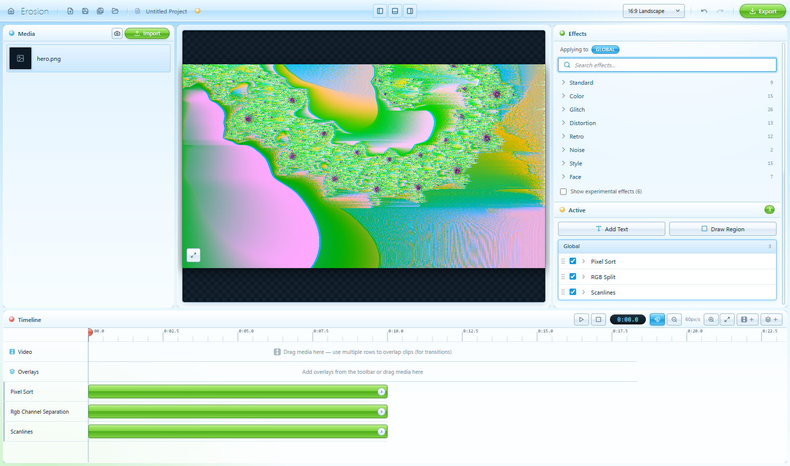

# Erosion Studio

A desktop photo and video editor for glitch art: datamosh, pixel sorting, codec damage, VHS, CRT, trails, face-tracked censoring and 100+ other effects, stacked live on photos, video timelines, or your webcam.



## Features

- **100+ stackable effects** across glitch, distortion, color, retro, noise, style and face categories. Most run on the GPU (WebGL2); heavier CPU-only effects run in a background worker so the UI stays responsive.
- **Timeline editing** — multiple video and image clips, image/video/text overlays, per-effect time windows and keyframed parameters.
- **Regions and effect zones** — apply effects to a drawn region or behind an overlay's shape.
- **Face-aware effects** — blur, pixelate or censor eyes/mouth using MediaPipe landmarks.
- **Live camera** — apply effects to your webcam, snap photos or record with effects baked in.
- **Export** — MP4, WebM and GIF (rendered offline, frame-accurate), PNG and JPEG stills.
- **Projects** — save/load `.eron` project files, recent projects, undo/redo.

## Getting started

Requirements: Node.js 22.12+ and npm.

```bash
npm install
npm run dev        # starts Vite and opens the Electron window
```

Build a distributable for your platform (output in `out/`):

```bash
npm run build
```

### Using it

1. **Import** media from the left panel, or drag files onto it (MP4, MOV, WebM, MKV, JPG, PNG, GIF, WebP).
2. Drag clips onto the timeline, or just select an item to preview it.
3. Pick effects from the right panel. Expand an effect in the stack to tweak its parameters; drag to reorder.
4. Press **Export** (⌘E).

| Shortcut | Action |
| --- | --- |
| Space | Play / pause |
| ⌘Z / ⌘⇧Z | Undo / redo |
| ⌘S / ⌘⇧S | Save / save as |
| ⌘N | New project |
| ⌘E | Export |

On Windows and Linux use Ctrl instead of ⌘.

## Development

| Command | What it does |
| --- | --- |
| `npm run dev` | Run the app with hot reload |
| `npm run typecheck` | TypeScript across renderer and Electron main |
| `npm run lint` | ESLint |
| `npm test` | Unit tests (Vitest) |
| `npm run check:shaders` | Compile every effect's GLSL in a real WebGL2 context |
| `npm run build` | Production build + installers |

Tech stack: Electron, React 18, TypeScript, Vite, Zustand, WebGL2, Three.js (3D style effects), MediaPipe (face tracking), FFmpeg (export, via `ffmpeg-static`).

- [Architecture](docs/architecture.md) — playback clock, render engine, GL pipeline, export.
- [Effects system](docs/effects-system.md) — how effects are registered and rendered.
- [Adding an effect](docs/adding-an-effect.md) — step-by-step guide with templates.
- [Roadmap](docs/roadmap.md) — known issues and planned work.

## Contributing

Contributions are welcome — new effects especially. See [CONTRIBUTING.md](CONTRIBUTING.md).

## License

Erosion Studio is [MIT](LICENSE) licensed.

### Third-party components

- **FFmpeg** — export uses the binary from [`ffmpeg-static`](https://github.com/eugeneware/ffmpeg-static), which is licensed **GPL-3.0-or-later** (it includes libx264). It runs as a separate process and is not linked into Erosion Studio. Installers built with `npm run build` bundle that binary together with its `LICENSE` and `README` (which point to the corresponding source); if you distribute builds, you take on the GPL's obligations for it.
- **MediaPipe** — face tracking uses [`@mediapipe/tasks-vision`](https://github.com/google-ai-edge/mediapipe) and Google's Face Landmarker model (`public/mediapipe/face_landmarker.task`), both Apache-2.0.
